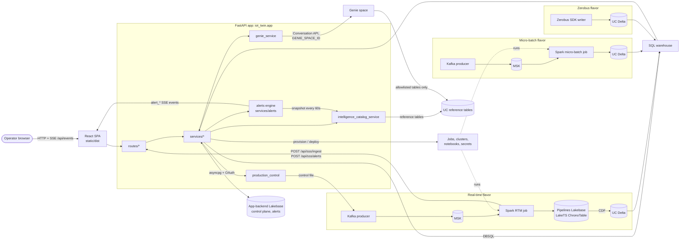

# Architecture

## Overview

The app is a single FastAPI service (`iot_twin.app:app`) that serves a React SPA and an
HTTP/SSE API. It orchestrates real Databricks resources per industry and pipeline flavor
and renders their live and historical data.

```
Browser (React SPA)
   │  HTTP + Server-Sent Events (/api/events)
   ▼
FastAPI app (src/iot_twin)
   ├── App-backend Lakebase   control-plane tables (industries, pipelines, alerts, …)
   ├── Pipelines Lakebase     per-industry streaming sink (LakeTS ChronoTable)
   ├── SQL warehouse (DBSQL)  historical queries over Unity Catalog Delta tables
   ├── Jobs / clusters        consumers, producers and LakeTS operational notebooks
   └── Genie space            natural-language copilot
```



## Startup

On boot the app:

1. Opens the app-backend Lakebase pool (OAuth token refresh) and creates its schema. If the
   database is unavailable (for example no `PGHOST`), it keeps running and `/api/health`
   reports the database as unavailable.
2. Publishes the app service principal's OAuth secret to the Unity Catalog secret that
   streaming jobs read.
3. Starts the simulator, the industry runtime refresh and the alert snapshot sync.
4. Serves the built SPA from `static/dist` and registers all API routers in one place
   (`routes.create_api_router`).

## Data flow by flavor

- **Real-time:** a producer writes to Kafka (MSK). A Spark Structured Streaming job in
  Real-Time Mode writes to the Lakebase LakeTS ChronoTable and POSTs each batch to
  `/api/sss/ingest`, which the app fans out over SSE.
- **Micro-batch:** Kafka to a Spark micro-batch job that writes a Unity Catalog Delta table.
- **Zerobus:** the Zerobus SDK writes straight to a Unity Catalog Delta table; there is no
  Spark job.

## Dashboard tiers

| Tier | Source | Used for |
|---|---|---|
| Live | SSE stream | KPI tiles, sensor stream, 3D twin |
| Hot | Lakebase ChronoTable per industry branch | write performance, sink health, LakeTS analytics |
| Cold | Delta table via Lakebase CDF, queried through DBSQL | historical time series |

Unity Catalog objects follow `{UC_CATALOG}.{UC_SCHEMA}.{industry}_{kind}`. Latency KPIs come
from per-mode metrics tables for real-time and micro-batch and from
`system.lakeflow.zerobus_ingest` for Zerobus.

## Two Lakebase roles

- **App backend** (`LAKEBASE_PROJECT`): shared control-plane tables for the app.
- **Pipelines project** (`PIPELINES_LAKEBASE_PROJECT`): per-industry sinks, provisioned at
  runtime.

## Authentication and authorization

User identity comes from the `x-forwarded-access-token` header inside the Apps runtime.
Admins are the app owner, members of `ADMIN_GROUP`, or addresses in the optional
`ADMIN_EMAILS` list. Outside the Apps runtime, `IOT_ALLOW_ANONYMOUS_IDENTITY=1` relaxes the
check for local work.

## What the bundle owns and what the app creates

The bundle manages the app, its resource bindings and permissions. The app creates the
per-industry resources at runtime: catalogs and schemas, volumes, pipeline Lakebase
branches and endpoints, jobs, clusters, notebooks and secrets. See
[deployment.md](deployment.md).

## Runtime wheel

Job clusters import `domain` and `scenario_engine` as top-level packages. The app builds a
wheel for them at runtime (`services/runtime_wheel_service.py`) by rewriting
`iot_twin.domain` and `iot_twin.scenario_engine` imports to the top-level names; tests
check the wheel contents and import it in a clean interpreter.

## Module map

| Area | Location |
|---|---|
| API routers | `src/iot_twin/routes/` |
| Provisioning and deployment | `services/provisioning_service.py`, `services/deployment/` |
| LakeTS | `services/lakets/` |
| Alerts | `services/alerts/` |
| Validation | `services/validation/` |
| Industry setup | `services/industry/` |
| Pipelines | `services/pipelines/` |
| Database access | `services/db/`, `core/lakebase.py` |
| Packaged data (`lakets.sql`) | `src/iot_twin/assets/` (resolved via `core/paths.py`) |
| Bundle resource definitions | `resources/` (top level, DABs only) |
| Workspace profiles, bundle overrides example | `deploy/` |
| Browser (Playwright) tests | `tests/e2e/playwright/` |

## Alerts

Alert rules come from the domain catalog (`domain/catalog.py`, `list_alert_rules`). The deterministic
state machine in `services/alerts/alert_engine.py` evaluates readings as they arrive:
`POST /api/sss/ingest` calls `evaluate_and_emit`, and `POST /api/sss/alerts` accepts threshold
alerts raised by streaming jobs. State is kept in memory and, when the app-backend Lakebase is
available, in the `alert` and `alert_event` tables. Each lifecycle change (`alert_opened`,
`alert_updated`, `alert_acknowledged`, `alert_cleared`) is pushed to browsers over the
`/api/events` SSE stream (`services/alerts/alert_sse.py`). `alert_history.py` rebuilds
per-episode history from `alert_event`, and `alert_responses.py` records operator decisions
against an episode. The REST surface is `routes/alerts.py`. A background loop
(`alert_snapshot_sync.py`, default every 60 s, `ALERT_SNAPSHOT_SYNC_INTERVAL_S`) copies the
current alerts to the `intelligence_alert_snapshot` table in Unity Catalog.

## Genie copilot

`routes/genie.py` exposes `/api/genie/*` (status, start a conversation, follow-up message,
poll a message). `services/genie_service.py` calls the Genie Conversation API server-side as
the app service principal and never blocks on waiters; each request is a start or a single
status poll. The space id arrives as `GENIE_SPACE_ID`, injected from the `genie-space` app
resource (`resources/app.yml`, permission `CAN_VIEW`); without it the routes answer 503.
Genie can explain and recommend but cannot change alerts. Table access is a data-source
allowlist on the Genie space, not prompt text: `allowed_uc_tables()` returns only the
intelligence reference tables, never industry telemetry, and `space_table_allowlist_status`
compares the space against that set.

## Intelligence catalog

`services/intelligence_catalog_service.py` provisions and syncs shared Delta reference tables
in `{UC_CATALOG}.{UC_SCHEMA}`: `intelligence_assets`, `intelligence_sensor_bindings`,
`intelligence_maintenance_records`, `intelligence_alert_rules` and `intelligence_alert_snapshot`
(a read-only snapshot of alerts). Admins inspect and trigger a full sync through
`GET /api/admin/intelligence/status` and `POST /api/admin/intelligence/sync`
(`routes/intelligence.py`).

## Production control

`services/production_control.py` stops and resumes a production cell. It writes a small control
file next to the industry's deployed notebooks; the Kafka producer polls it about once a second
and stops or resumes the cell machines' sensors (today `manufacturing`: `cnc_1`,
`assy_line_1`). The streaming job itself is never paused, so Lakebase, SSE and the alert
engine see the cell go quiet. The app records the new state only after the control file is
written. REST: `GET/POST /api/industries/{industry}/production` and
`GET /api/industries/{industry}/production/events` (`routes/production.py`).
